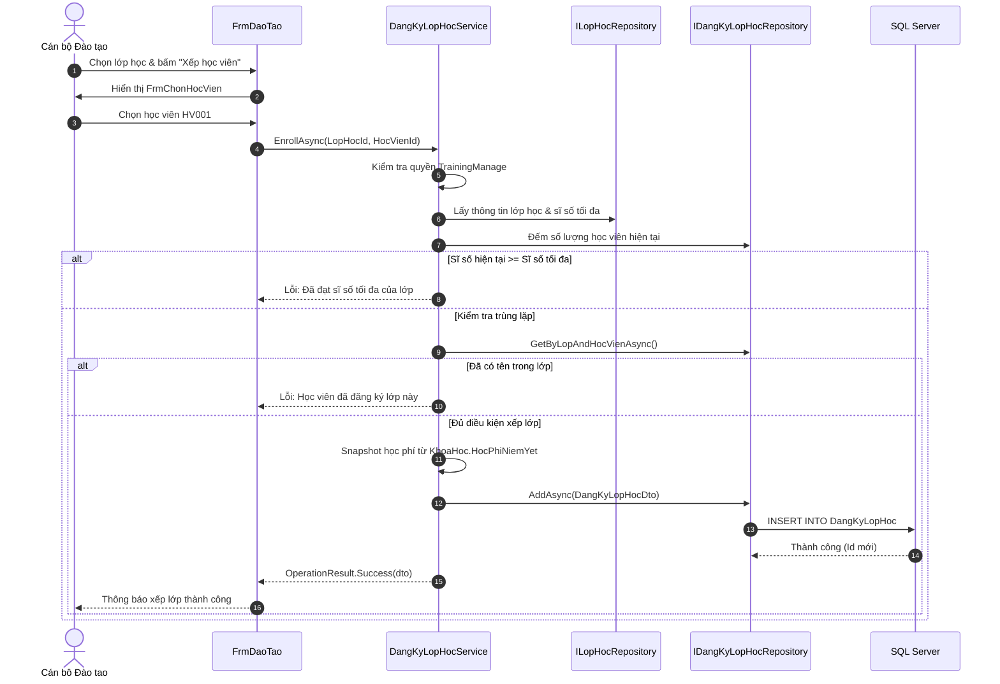
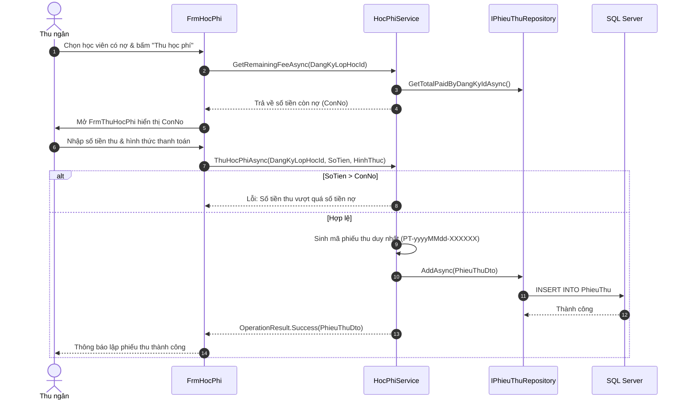

# PHÂN TÍCH & THIẾT KẾ KIẾN TRÚC - HỆ THỐNG QUẢN LÝ HỌC VIÊN (QLHV)

## 1. Kiến Trúc Tổng Thể (Layered Architecture)
Hệ thống được thiết kế theo mô hình phân tầng chặt chẽ (Clean / Layered Architecture) nhằm phân tách rõ trách nhiệm giữa các thành phần:

```
[QLHV.WinForms (Presentation / UI)]
         │
         ▼
[QLHV.Features.Catalog & QLHV.Features.Training (Application Services)]
         │
         ▼
[QLHV.Core (Domain Contracts, Abstractions, Security, Validation)]
         ▲
         │ (Implements Interfaces)
[QLHV.Infrastructure.SqlServer (Data Access / ADO.NET)]
```

### 1.1. Các Project Trong Solution
1. **`QLHV.Contracts`:**
   - Chứa các Data Transfer Objects (DTO), Enums, Query Filters, và kết quả chuẩn hóa `OperationResult<T>`.
   - Không chứa bất kỳ logic nghiệp vụ hoặc thư viện ngoài nào.
2. **`QLHV.Core`:**
   - Chứa Repository Interfaces (`IHocVienRepository`, `ILopHocRepository`,...), Service Interfaces (`ILopHocService`,...), Security (`IPasswordHasher`, `AuthorizationGuard`), Database abstraction (`IConnectionFactory`), Logging (`IAppLogger`), và Helper validation.
3. **`QLHV.Features.Catalog`:**
   - Xử lý nghiệp vụ danh mục cơ sở (Học viên, Giảng viên, Môn học, Khóa học, Phòng học, Xác thực đăng nhập).
   - Chứa các Fake Repositories danh mục in-memory.
4. **`QLHV.Features.Training`:**
   - Xử lý toàn bộ nghiệp vụ vận hành: Lớp học, Xếp lớp học viên, Lịch học, Kết quả học tập, Học phí và Báo cáo.
   - Chứa `FakeTrainingStore` (bộ nhớ chia sẻ luồng an toàn) và 6 Fake repositories.
5. **`QLHV.Infrastructure.SqlServer`:**
   - Triển khai toàn bộ các Repository interfaces bằng công nghệ ADO.NET thuần trên Microsoft SQL Server.
   - Quản lý kết nối, giao dịch, tham số hóa SQL (chống SQL Injection), và chuyển đổi dữ liệu an toàn.
6. **`QLHV.WinForms`:**
   - Tầng giao diện người dùng Windows Forms, đóng vai trò Composition Root (tập trung khởi tạo các dịch vụ tại `Program.cs` thông qua Constructor Injection, không dùng thư viện DI cồng kềnh).
7. **`QLHV.Tests`:**
   - Dự án kiểm thử tự động toàn diện: Unit tests, Security authorization tests, UI smoke tests và SQL Server integration tests.

## 2. Thiết Kế Luồng Xử Lý Nghiệp Vụ

### 2.1. Luồng Mở Lớp & Xếp Học Viên


### 2.2. Luồng Lập Lịch & Chống Xung Đột
- Khi tạo/cập nhật buổi học:
  $$\text{Xung đột nếu: } (\text{Start}_{\text{mới}} < \text{End}_{\text{cũ}}) \land (\text{End}_{\text{mới}} > \text{Start}_{\text{cũ}})$$
- Kiểm tra áp dụng đồng thời cho cả **Phòng học** và **Giảng viên** trong cùng một ngày.

### 2.3. Luồng Thu Học Phí & Công Nợ


## 3. Ma Trận Phân Quyền (RBAC Matrix)

| Vai trò / Quyền | CatalogView | CatalogManage | TrainingView | TrainingManage | TuitionManage | GradeEntry | ReportView | UserManage |
| :--- | :---: | :---: | :---: | :---: | :---: | :---: | :---: | :---: |
| **ADMIN** | ✅ | ✅ | ✅ | ✅ | ✅ | ✅ | ✅ | ✅ |
| **DAOTAO** | ✅ | ✅ | ✅ | ✅ | ❌ | ❌ | ❌ | ❌ |
| **THUNGAN** | ✅ | ❌ | ❌ | ❌ | ✅ | ❌ | ❌ | ❌ |
| **GIANGVIEN** | ✅ | ❌ | ❌ | ❌ | ❌ | ✅ | ❌ | ❌ |
| **QUANLY** | ✅ | ❌ | ❌ | ❌ | ❌ | ❌ | ✅ | ❌ |

- Toàn bộ việc kiểm tra quyền hạn được thực hiện nghiêm ngặt ở tầng Application Service thông qua `AuthorizationGuard.EnsurePermission`, không phụ thuộc vào trạng thái ẩn/hiện của giao diện người dùng.
