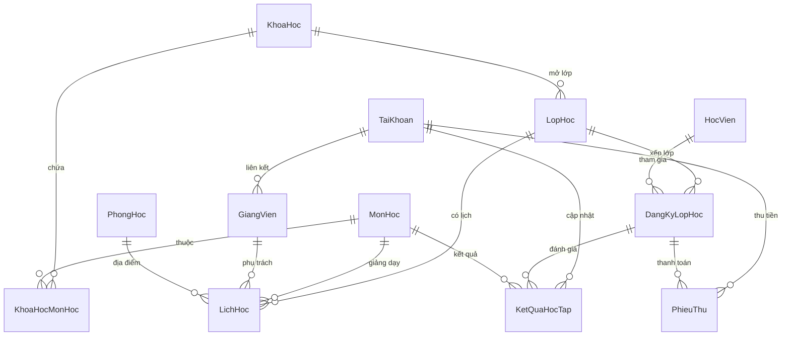

# SƠ ĐỒ THỰC THỂ QUAN HỆ (ERD) & TỪ ĐIỂN DỮ LIỆU - QLHV

## 1. Sơ Đồ ERD Hệ Thống

## 2. Từ Điển Dữ Liệu Chi Tiết

### 2.1. Bảng `LopHoc` (Lớp học đào tạo)
| Tên Cột | Kiểu Dữ Liệu | Ràng Buộc | Ý Nghĩa Nghiệp Vụ |
| :--- | :--- | :--- | :--- |
| `Id` | `INT` | PK, IDENTITY | Khóa chính tự tăng |
| `MaLopHoc` | `NVARCHAR(20)` | UNIQUE, NOT NULL | Mã lớp tự nhiên (VD: LH_NET_01) |
| `TenLopHoc` | `NVARCHAR(150)` | NOT NULL | Tên lớp học đào tạo |
| `KhoaHocId` | `INT` | FK -> `KhoaHoc(Id)` | Khóa học tương ứng |
| `NgayBatDau` | `DATE` | NOT NULL | Ngày khai giảng lớp học |
| `NgayKetThuc`| `DATE` | NULL | Ngày kết thúc dự kiến (>= NgayBatDau) |
| `SiSoToiDa` | `INT` | NOT NULL (1..200) | Giới hạn sĩ số của lớp |
| `GhiChu` | `NVARCHAR(500)`| NULL | Ghi chú ca học, phòng học |
| `TrangThai` | `INT` | NOT NULL, DEFAULT 1 | 1: Đang hoạt động, 0: Ngừng hoạt động |
| `NgayTao` | `DATETIME2(7)` | NOT NULL | Thời điểm tạo bản ghi |

### 2.2. Bảng `DangKyLopHoc` (Xếp học viên vào lớp)
| Tên Cột | Kiểu Dữ Liệu | Ràng Buộc | Ý Nghĩa Nghiệp Vụ |
| :--- | :--- | :--- | :--- |
| `Id` | `INT` | PK, IDENTITY | Khóa chính tự tăng |
| `LopHocId` | `INT` | FK -> `LopHoc(Id)` | Khóa ngoại lớp học |
| `HocVienId` | `INT` | FK -> `HocVien(Id)` | Khóa ngoại học viên |
| `NgayDangKy` | `DATE` | NOT NULL | Ngày xếp học viên vào lớp |
| `HocPhiPhaiThu` | `DECIMAL(18,2)` | NOT NULL (>= 0) | Học phí niêm yết tại thời điểm đăng ký (Snapshot) |
| `GhiChu` | `NVARCHAR(250)`| NULL | Ghi chú đợt đăng ký |
| `TrangThai` | `INT` | NOT NULL, DEFAULT 1 | 1: Đang học, 0: Đã hủy đăng ký |
| `NgayTao` | `DATETIME2(7)` | NOT NULL | Thời điểm ghi nhận đăng ký |
*(Ràng buộc duy nhất: `UNIQUE(LopHocId, HocVienId)`)*

### 2.3. Bảng `LichHoc` (Chi tiết buổi học)
| Tên Cột | Kiểu Dữ Liệu | Ràng Buộc | Ý Nghĩa Nghiệp Vụ |
| :--- | :--- | :--- | :--- |
| `Id` | `INT` | PK, IDENTITY | Khóa chính tự tăng |
| `LopHocId` | `INT` | FK -> `LopHoc(Id)` | Khóa ngoại lớp học |
| `MonHocId` | `INT` | FK -> `MonHoc(Id)` | Môn học diễn ra trong buổi |
| `GiangVienId`| `INT` | FK -> `GiangVien(Id)` | Giảng viên đứng lớp |
| `PhongHocId` | `INT` | FK -> `PhongHoc(Id)` | Phòng học tổ chức |
| `NgayHoc` | `DATE` | NOT NULL | Ngày diễn ra buổi học |
| `GioBatDau` | `TIME(0)` | NOT NULL | Giờ bắt đầu buổi học |
| `GioKetThuc` | `TIME(0)` | NOT NULL | Giờ kết thúc (> GioBatDau) |
| `NoiDung` | `NVARCHAR(500)`| NULL | Nội dung bài học giảng dạy |
| `TrangThai` | `INT` | NOT NULL, DEFAULT 1 | 1: Đang học, 0: Đã hủy buổi học |

### 2.4. Bảng `KetQuaHocTap` (Điểm số học viên)
| Tên Cột | Kiểu Dữ Liệu | Ràng Buộc | Ý Nghĩa Nghiệp Vụ |
| :--- | :--- | :--- | :--- |
| `Id` | `INT` | PK, IDENTITY | Khóa chính tự tăng |
| `DangKyLopHocId` | `INT` | FK -> `DangKyLopHoc(Id)` | Lượt đăng ký của học viên |
| `MonHocId` | `INT` | FK -> `MonHoc(Id)` | Môn học được đánh giá |
| `DiemTongKet`| `DECIMAL(4,2)` | NOT NULL (0..10) | Điểm tổng kết môn học |
| `NguoiCapNhatTaiKhoanId` | `INT` | FK -> `TaiKhoan(Id)` | Tài khoản nhập/sửa điểm |
| `NgayCapNhat`| `DATETIME2(7)`| NOT NULL | Thời điểm lưu điểm |
| `GhiChu` | `NVARCHAR(250)`| NULL | Nhận xét của giảng viên |
*(Ràng buộc duy nhất: `UNIQUE(DangKyLopHocId, MonHocId)`)*

### 2.5. Bảng `PhieuThu` (Biên lai thu học phí)
| Tên Cột | Kiểu Dữ Liệu | Ràng Buộc | Ý Nghĩa Nghiệp Vụ |
| :--- | :--- | :--- | :--- |
| `Id` | `INT` | PK, IDENTITY | Khóa chính tự tăng |
| `MaPhieuThu` | `NVARCHAR(30)` | UNIQUE, NOT NULL | Mã phiếu thu tự nhiên |
| `DangKyLopHocId` | `INT` | FK -> `DangKyLopHoc(Id)` | Đợt xếp lớp được thanh toán |
| `NgayThu` | `DATETIME2(7)`| NOT NULL | Thời điểm lập phiếu thu |
| `SoTien` | `DECIMAL(18,2)` | NOT NULL (> 0) | Số tiền thực thu |
| `HinhThuc` | `NVARCHAR(20)` | NOT NULL (TIEN_MAT, CHUYEN_KHOAN) | Hình thức thanh toán |
| `NguoiThuTaiKhoanId` | `INT` | FK -> `TaiKhoan(Id)` | Thu ngân/nhân viên lập phiếu |
| `GhiChu` | `NVARCHAR(250)`| NULL | Ghi chú biên nhận |
| `TrangThai` | `INT` | NOT NULL, DEFAULT 1 | 1: Hiệu lực, 0: Đã hủy |
| `LyDoHuy` | `NVARCHAR(250)`| NULL | Lý do bắt buộc khi hủy phiếu |
| `NgayHuy` | `DATETIME2(7)`| NULL | Thời điểm hủy phiếu thu |
| `NguoiHuyTaiKhoanId` | `INT` | FK -> `TaiKhoan(Id)`, NULL | Tài khoản thực hiện hủy phiếu |

### 2.6. Quy Chuẩn Collation
1. `Vietnamese_100_CI_AS`: Áp dụng cho các cột mã code nghiệp vụ (`MaLopHoc`, `MaPhieuThu`, `MaHocVien`,...) phân biệt hoa thường và dấu tiếng Việt chính xác.
2. `Vietnamese_100_CI_AI`: Áp dụng cho các cột văn bản, họ tên, ghi chú nhằm hỗ trợ tìm kiếm tiếng Việt không phân biệt dấu.
3. `Latin1_General_100_BIN2`: Áp dụng cho các chuỗi token hoặc enum dạng chuỗi (`HinhThuc`).
